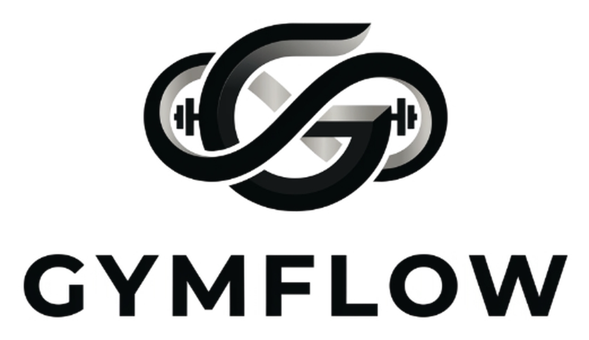
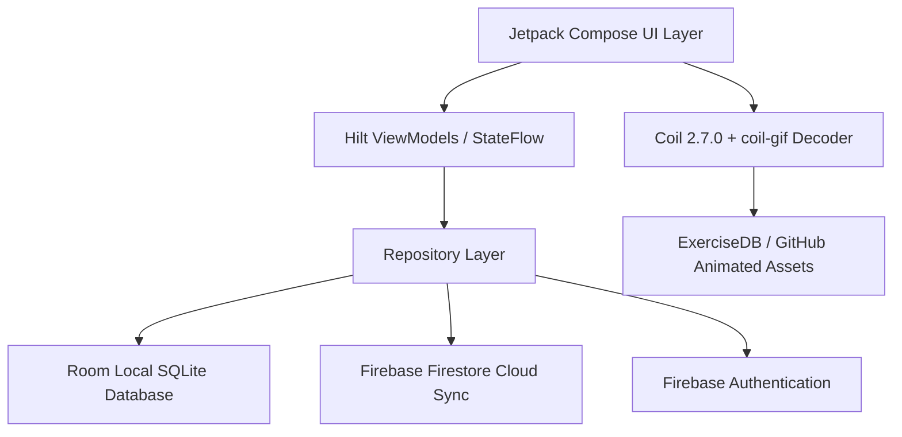

# GYMFLOW — Fitness & Discipline Platform

<div align="center">
  
  <h3>TRAIN · TRACK · IMPROVE</h3>
  <p>A dual-experience fitness ecosystem for gym members and personal trainers built with modern Android, Jetpack Compose, Room DB, Firebase, and hardware-accelerated animated exercise demonstrations.</p>

  <p>
    
    
    
    
    
    
  </p>
</div>

---

## 🌟 Key Features

### 1. Dual-Experience Architecture
- **Member Experience**: High-contrast, minimalist **Black & White UI** (`#FFFFFF` base, `#000000` primary) designed for focus, distraction-free logging, and rapid workout execution.
- **Trainer Studio**: Professional **OLED Dark Mode** (`#09090B` base, `#141416` surfaces) tailored for personal trainers to manage active rosters, prescribe workouts, and review metrics.
- **Bidirectional Sync**: Real-time member-trainer synchronization powered by unique invitation codes (`GYM-XXXXX`) backed by Firebase Firestore.

### 2. Multi-Muscle Exercise Catalog & Live Movement Loops
- **43 Verified Exercises**: Full coverage across **Chest, Back, Shoulders, Biceps, Triceps, Legs, and Abs**.
- **Looping Animated Demonstration GIFs**: Real-time movement demonstrations streamed from open-source repository `omercotkd/exercises-gifs`, decoded using `io.coil-kt:coil-gif` with hardware acceleration.
- **Interactive Media Player**: One-tap toggle between **`● GIF DEMO`** and high-resolution **`HD PHOTO`**, complete with pause/play controls and step-by-step coaching cues.

### 3. Acute Fluid Loss & Weight Metric Tracking
- **Pre & Post-Workout Weigh-In**: Interactive weight spinner dialog with fine-grained stepper adjustments (`±0.1 kg`, `±1.0 kg`).
- **Live Sweat & Hydration Formula**: Automatically calculates net acute fluid loss and prescribes exact rehydration volumes:
  $$\text{Rehydration Volume (ml)} = (\text{Weight}_{\text{pre}} - \text{Weight}_{\text{post}}) \times 1.25 \times 1000$$
- **Persistent Trend Graph**: Tracks acute fluctuations and multi-day trends with instant Room database updates.

### 4. Self-Managed Workout Routine Builder
- Full weekly schedule management (Monday through Sunday).
- One-click exercise assignment with machine/equipment specs, sets, reps, and target weights.
- Real-time updates reflected across Home dashboard and Schedule tabs.

### 5. Custom Branded Web Verification & Auth Action Portal
- Built-in Firebase Authentication action handler hosted at `https://gymflow-fitness-app.web.app/action.html`.
- High-end dark glassmorphic design system matching GymFlow brand aesthetics.
- Seamless mobile deep linking (`gymflow://auth`) to return users directly to the native app upon email verification.

---

## 🛠️ Architecture & Tech Stack



- **Language**: Kotlin 2.0.21
- **UI Toolkit**: Jetpack Compose with Material 3 Monochrome Design Tokens
- **Dependency Injection**: Dagger Hilt 2.52
- **Persistence**: Room Database (SQLite) + Encrypted SharedPreferences
- **Remote Backend**: Firebase Auth, Cloud Firestore, Firebase Hosting
- **Image & Animation Engine**: Coil 2.7.0 with `ImageDecoderDecoder` (Android P+) and `GifDecoder`
- **Minimum SDK**: Android 8.0 (API Level 26)
- **Target SDK**: Android 15 (API Level 35)

---

## 🚀 Getting Started

### Prerequisites
- Android Studio Ladybug | 2024.2.1 or newer
- JDK 17 or JDK 21
- Android SDK 35

### Clone & Build
```bash
# Clone the repository
git clone https://github.com/<your-username>/GYMFLOW.git
cd GYMFLOW

# Build debug APK
./gradlew :app:assembleDebug

# Run unit test suite
./gradlew testDebugUnitTest
```

### Deploying the Web Verification Portal
```bash
# Deploy custom auth portal to Firebase Hosting
firebase deploy --only hosting
```

---

## 📄 License
This project is licensed under the Apache License, Version 2.0.
