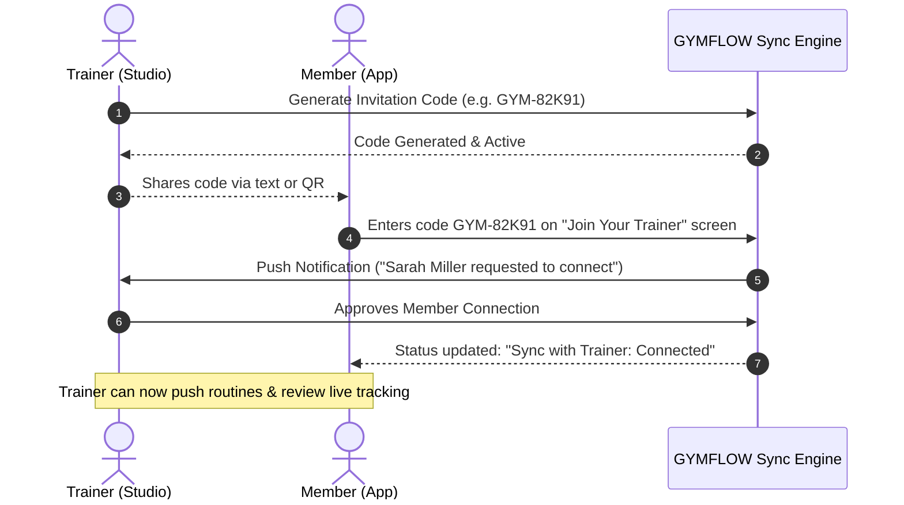
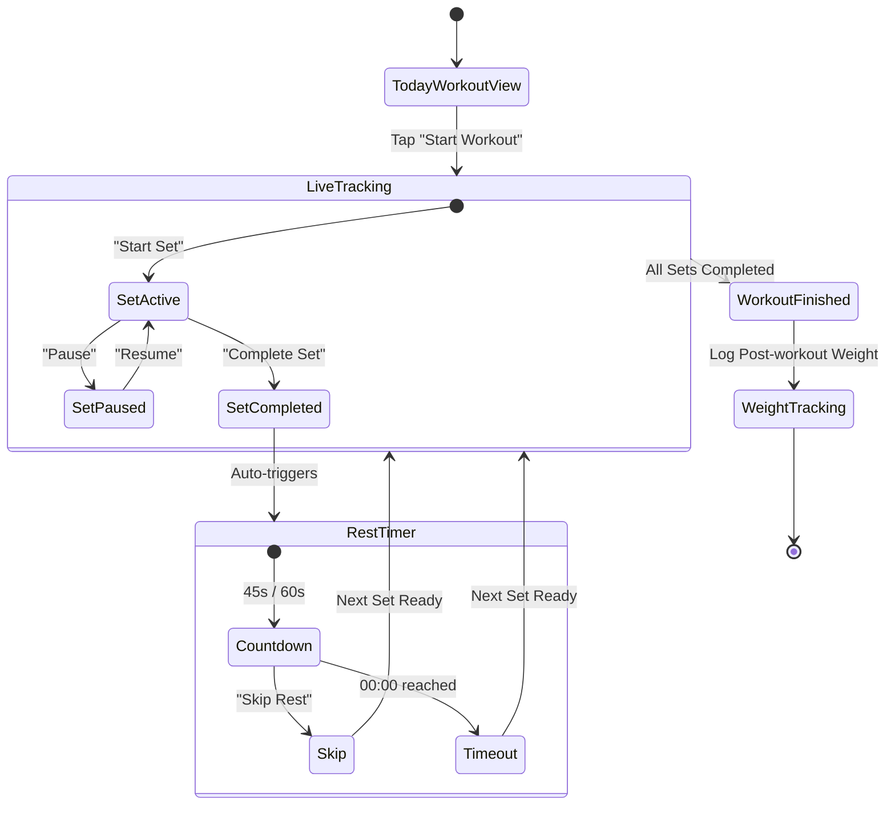

# GYMFLOW — UI/UX Design System & Screen Specifications
**TRAIN · TRACK · IMPROVE**

> **Overview**: GYMFLOW is a dual-experience fitness platform providing an independent yet synchronously connected ecosystem for gym members and personal trainers.
> - **Member App**: Clean, distraction-free **Black & White UI** (Light theme with high-contrast monochrome aesthetics, featuring an OLED dark rest timer).
> - **Trainer App (Studio)**: Professional **Dark Mode UI** tailored for high-efficiency member management, plan creation, and workout review.
> - **Sync Architecture**: Real-time bidirectional connection powered by unique invitation codes (`GYM-XXXXX`).

---

## 1. Visual Identity & Brand Foundations

| Attribute | Specification |
| :--- | :--- |
| **Brand Name** | GYMFLOW |
| **Tagline** | TRAIN · TRACK · IMPROVE |
| **Member Aesthetic** | Modern Swiss Minimalist / High-Contrast Monochrome Light (`#FFFFFF` base, `#000000` primary) |
| **Trainer Aesthetic** | Studio Pro / OLED Dark (`#0A0A0A` base, `#18181B` surfaces, `#FFFFFF` text) |
| **Accents** | Success/Active Green (`#22C55E`), Pending Amber (`#F59E0B`), Warning/Destructive Red (`#EF4444`) |
| **Iconography** | Clean geometric line icons (Lucide/Heroicons/Phosphor compatible), dumbbell badge motif |
| **Geometry** | Balanced border radii: Pill buttons (`9999px`), rounded card containers (`16px` to `20px`), subtle `1px` crisp borders |

---

## 2. Design Tokens & Color Systems

### 2.1 Member App Tokens (Light Mode Primary)
```css
:root {
  /* Member Surface & Background */
  --member-bg: #FFFFFF;
  --member-surface: #F8F9FA;
  --member-surface-subtle: #F1F3F5;
  --member-card-border: #E5E7EB;

  /* Typography & Foreground */
  --member-text-primary: #000000;
  --member-text-secondary: #6B7280;
  --member-text-tertiary: #9CA3AF;

  /* Interactive & Accent */
  --member-btn-primary-bg: #000000;
  --member-btn-primary-fg: #FFFFFF;
  --member-btn-secondary-bg: #F3F4F6;
  --member-btn-secondary-fg: #111827;

  /* Status Colors */
  --status-active: #22C55E;
  --status-pending: #F59E0B;
  --status-destructive: #EF4444;

  /* Special Rest Screen (OLED Mode) */
  --rest-bg: #000000;
  --rest-fg: #FFFFFF;
  --rest-ring: #FFFFFF;
  --rest-muted: #27272A;
}
```

### 2.2 Trainer App Tokens (Dark Mode Studio)
```css
:root {
  /* Trainer Surface & Background */
  --trainer-bg: #09090B;
  --trainer-surface: #141416;
  --trainer-surface-card: #1E1E22;
  --trainer-card-border: #27272A;

  /* Typography & Foreground */
  --trainer-text-primary: #FFFFFF;
  --trainer-text-secondary: #A1A1AA;
  --trainer-text-tertiary: #71717A;

  /* Interactive & Accent */
  --trainer-btn-primary-bg: #FFFFFF;
  --trainer-btn-primary-fg: #000000;
  --trainer-btn-card-bg: #27272A;
  --trainer-btn-card-fg: #FFFFFF;

  /* Badges */
  --badge-active-bg: rgba(34, 197, 94, 0.15);
  --badge-active-fg: #4ADE80;
  --badge-pending-bg: rgba(245, 158, 11, 0.15);
  --badge-pending-fg: #FBBF24;
}
```

### 2.3 Typography Scale
- **Display / Hero**: `32px` – `36px` | Bold / Black (e.g., `GYMFLOW`, Rest Timer `00:45`)
- **Heading 1**: `24px` | SemiBold (e.g., "Good morning, Alex!", "Welcome Back")
- **Heading 2**: `18px` – `20px` | Medium / SemiBold (Section titles, exercise names)
- **Body Regular**: `14px` – `15px` | Regular (Instructions, metrics description)
- **Caption / Meta**: `12px` – `13px` | Medium (Subtitles, badge text, dates, sets & reps)
- **Font Stack**: `Plus Jakarta Sans`, `Inter`, or `Barlow` (Athletic modern grotesk).

---

## 3. Screen Breakdown — Member App (User Experience)

### Screen 1: Splash Screen
- **Visuals**: Full-height grayscale athletic gym photography (hero athlete back profile).
- **Header Elements**: Dumbbell emblem + "GYMFLOW" typographic brand mark.
- **Tagline**: "Your Fitness. Your Progress. Your Discipline."
- **CTAs**:
  - Primary: White pill button "Get Started" (`h-13`, full-width, text-black).
  - Secondary: Subtext link "Already have an account? Login".

### Screen 2: Login Screen
- **Header**: Navigation back arrow (`<-`), centered GYMFLOW logo.
- **Titles**: "Welcome Back" (H1), "Login to continue your journey" (Subtitle).
- **Form**:
  - `Email or Phone`: Input field with placeholder `you@example.com`.
  - `Password`: Masked input field with reveal/hide eye icon.
  - "Forgot Password?" right-aligned link.
- **Actions**:
  - Primary: Solid black button "Login" (`w-full`, rounded-full).
  - Divider: Text divider `— or —`.
  - Outlined button: "Login with Join Code" (key icon).
  - Bottom link: "Create Account".

### Screen 3: Home Dashboard
- **Top Bar**: "GYMFLOW [Member]" badge, notification bell with unread dot, user avatar.
- **Greeting**: "Good morning, Alex!" + "Ready to achieve your goals?".
- **Metric Cards (2x2 Grid)**:
  1. *Current Weight*: `67.8 kg` (Scale icon).
  2. *Calories Today*: `320 kcal` (Flame icon).
  3. *Exercises*: `4/5` (Dumbbell icon).
  4. *Workout Duration*: `48 min` (Stopwatch icon).
- **Today's Workout Section**:
  - Header: "Today's Workout" with right-side "View All" link.
  - Subhead: "Chest Day".
  - Exercise Items (with thumbnail previews):
    - `Chest Press`: "3 sets · 12 reps · 20 kg".
    - `Cable Fly`: "3 sets · 12 reps · 10 kg".
- **Primary CTA**: Large full-width black button `Start Workout ▶`.
- **Bottom Navigation**: 5 items: Home (active), Schedule, Progress, Activity, Profile.

### Screen 4: Workout Schedule
- **Header**: Back button, "Workout Schedule", Calendar icon.
- **Weekly Date Strip**: Horizontal selector with days `Mon 12` through `Sun 18` (Active day in filled black pill).
- **Daily Workout List**:
  - Mon: "Chest + Triceps" — Completed green check circle (`✓`).
  - Tue: "Back + Biceps" — Completed green check circle (`✓`).
  - Wed: "Legs" — Completed green check circle (`✓`).
  - Thu: "Shoulders" — Upcoming empty circle (`○`).
  - Fri: "Chest + Abs" — Upcoming empty circle (`○`).
  - Sat: "Back + Legs" — Upcoming empty circle (`○`).
  - Sun: "Rest" — Upcoming empty circle (`○`).
- **Persistent Bottom Nav**.

### Screen 5: Exercise Details
- **Header**: Back arrow, "Chest Press", metadata subhead "3 sets · 12 reps · 20 kg".
- **Hero Media**: Video/photo demonstration of barbell bench press.
- **Segmented Tabs**: `[Instructions]` (active with underline) | `[Muscle Info]`.
- **Step-by-step Guide**:
  1. "Keep your back flat on the bench."
  2. "Grip the bar slightly wider than shoulder width."
  3. "Lower the bar to your chest."
  4. "Push back up and repeat."
- **Action Button**: Fixed bottom pill "Start Set 1".

### Screen 6: Live Workout Tracking
- **Header**: Close icon (`✕`), green active status pill `[WORKOUT ACTIVE]`, workout tag `Chest Day`.
- **Exercise Info**: "Bench Press" title + exercise media.
- **Timer Display**: Large `02:35` counter with label `EXERCISE DURATION`.
- **Target Metrics (3 Columns)**:
  - Sets: `3`
  - Reps: `12`
  - Target: `20 kg`
- **Progress Indicator**: "Current Set: Set 2 of 3" with animated percentage bar (`67%`).
- **Workout Controls**:
  - `|| Pause` (Secondary outlined button).
  - `✓ Complete Set` (Primary black button).
- **Helper Note**: "Rest timer starts automatically after completing a set".

### Screen 7: Rest Timer (Contextual OLED Dark Mode)
- **Immersion**: Instant switch to high-contrast pitch-black screen (`#000000`).
- **Headline**: "Rest Time" in clean white typography.
- **Timer Display**: Large circular progress ring with centered countdown `00:45`.
- **Upcoming Set Card**:
  - Label: "Next Set".
  - Detail: "Set 3 of 3 — Bench Press (12 reps · 20 kg)".
- **Action**: Outline pill button "Skip Rest".

### Screen 8: Daily Weight Tracking
- **Header**: Back button, "Weight Tracking".
- **Filter Switcher**: Segmented toggle `[Daily]` (active) | `[Weekly]` | `[Monthly]`.
- **Comparison Cards (2 columns)**:
  - `Pre-workout`: `67.80 kg`.
  - `Post-workout`: `67.50 kg`.
- **Difference Indicator**:
  - Banner: `Difference: -0.30 kg`.
  - Explanatory note: "This is an immediate weight change, mostly reflecting fluid loss and other short-term fluctuations."
- **Trend Line Graph**: 7-day curve plotting weights against a Y-axis (`67.0` to `68.5 kg`).

### Screen 9: Progress Analytics
- **Header**: "Progress".
- **Time Range Selector**: `[7D]` (active) | `[30D]` | `[3M]` | `[6M]` | `[1Y]`.
- **Aggregated Stat Grid (2x2)**:
  - Total Workouts: `18`
  - Total Sets: `342`
  - Total Reps: `4,126`
  - Calories Burned: `5,480`
- **Weight Progress Chart**: Line graph displaying weight over weeks (Apr 1 – Apr 29).

### Screen 10: Member Profile
- **Header**: "Profile".
- **Avatar & Identity**: Profile picture, "Alex Johnson", badge "Member · Joined 12 Apr 2025".
- **Personal Info Summary**:
  - Age: `28` | Height: `178 cm` | Goal: `Build Muscle`
- **Settings Navigation**:
  - Body Measurements (`>`)
  - Fitness Goals (`>`)
  - Notifications (`>`)
  - Settings (`>`)

### Screen 11: Notifications
- **Header**: "Notifications".
- **Feed Items**:
  - "Workout plan updated" — Your trainer updated your chest day plan (2h ago).
  - "New note from trainer" — Try to increase weight next week (5h ago).
  - "Workout completed" — Great job! You completed 4/5 exercises (1d ago).
  - "Weekly streak" — You're on a 5 day streak! 🔥 (1d ago).
  - "Reminder" — Don't forget to log your weight today (2d ago).

### Screen 12: Join Code (Member Sync)
- **Header**: Back button, "Join Your Trainer".
- **Instructions**: "Enter Invitation Code — Get your unique code from your trainer".
- **Input Field**: Large monospace/capitalized input `e.g. GYM-82K91`.
- **CTA**: Full-width black button "Join".
- **Help Link**: "Need help?".

### Screen 13: Settings
- **Options**:
  - Account (`>`), Privacy (`>`), Sync with Trainer (`Connected >`), Theme (`Light >`), Help & Support (`>`), About (`>`).
  - Destructive Action: `Log Out` (with red exit icon).

---

## 4. Screen Breakdown — Trainer App (Studio Dark Mode)

### Screen 1: Trainer Splash
- **Visuals**: Dark atmospheric silhouette athletic photography.
- **Branding**: Dumbbell icon + "GYMFLOW TRAINER STUDIO".
- **Tagline**: "Manage. Plan. Motivate."
- **CTAs**: "Login" button, "Create Account" secondary.

### Screen 2: Trainer Login
- **Branding**: Centered GYMFLOW Trainer mark.
- **Form**: Email (`trainer@gymflow.com`), Password with toggle, "Login" button, "Forgot Password?".

### Screen 3: Trainer Dashboard
- **Greeting**: "Trainer Studio", "Good morning, Coach!".
- **Studio KPI Grid (2x2)**:
  - `32` Total Members | `24` Active Members
  - `18` Completed Today | `6` Pending Reviews
- **Connected Members Section**:
  - Member rows with live workout activity and status badges:
    - *Sarah Miller*: `Chest + Triceps · Today` — `Active` (green badge).
    - *Mike Ross*: `Leg Day · Today` — `Pending` (amber badge).
    - *Emma Davis*: `Back + Biceps · Today` — `Active` (green badge).
- **Floating Action**: `+ Create Workout Plan` pill button.

### Screen 4: Member Management
- **Search**: "Search members..." search bar with icon.
- **Filter Tabs**: `[All]` (active) | `[Active]` | `[Pending]`.
- **Roster Cards**:
  - Sarah Miller (`Active`)
  - Mike Ross (`Pending`)
  - Emma Davis (`Active`)
  - James Wilson (`Active`)
  - Olivia Brown (`Active`)
  - Daniel Carter (`Pending`)

### Screen 5: Create Workout Plan
- **Header**: Back arrow, "Create Workout Plan".
- **Member Assignment Dropdown**: Selected member card (e.g., `Sarah Miller`).
- **Weekly Schedule Builder**:
  - Day selector tabs: `Mon`, `Tue`, `Wed`, `Thu`, `Fri`, `Sat`, `Sun`.
  - Reorderable routine assignments:
    - Mon: Chest + Triceps (`>`)
    - Tue: Back + Biceps (`>`)
    - Wed: Legs (`>`)
    - Thu: Shoulders (`>`)
    - Fri: Chest + Abs (`>`)
    - Sat: Back + Legs (`>`)
    - Sun: Rest (`>`)
- **Primary CTA**: Sticky bottom button `+ Save Plan`.

### Screen 6: Exercise Library
- **Header**: "Exercise Library" with search bar.
- **Muscle Category Filter Chips**: `[All]`, `[Chest]`, `[Back]`, `[Legs]`, `[Shoulders]`.
- **Exercise Directory**:
  - Bench Press (Chest · Barbell)
  - Incline Dumbbell Press (Chest · Dumbbell)
  - Chest Fly (Chest · Machine)
  - Squat (Legs · Barbell)
  - Leg Press (Legs · Machine)
  - Deadlift (Back · Barbell)

### Screen 7: Member Progress (Trainer View)
- **Header**: Back arrow, "Member Progress" — `Sarah Miller`.
- **View Selector**: `[Overview]` (active) | `[Workouts]` | `[Stats]`.
- **Weight Progress Graph**: Live line chart (`62 kg` current).
- **Performance Metrics**:
  - Total Workouts: `12`
  - Total Sets: `248`
  - Total Calories: `3,850`
  - Best Bench Press: `30 kg`

### Screen 8: Trainer Settings
- **Menu Items**: Trainer Profile, Manage Members, Workout Plans, Exercise Library, Notifications, Help & Support, About, Log Out.

---

## 5. System Architecture & Workflows

### 5.1 Trainer-Member Connection Lifecycle


### 5.2 Live Workout & Rest Loop


---

## 6. Installed Design Intelligence Skill

The full **UI/UX Pro Max** design toolkit and accompanying design skills have been copied from `D:\campusconnect\ui-ux-pro-max-skill` directly into `.agents/skills/`:
- `ui-ux-pro-max` (Search engine with 84 styles, 192 palettes, 74 font pairings, 98 UX guidelines)
- `ui-styling` (shadcn/ui + Tailwind utility design rules)
- `design-system` (Semantic token architecture & CSS variables)
- `design` (Brand identity, SVG generators, visual direction)
- `brand` (Tone of voice, asset management)
- `banner-design` (Hero banners, promotional graphics)
- `slides` (Visual presentations & deck generation)

### CLI Command to Query Design Tokens
```bash
python .agents/skills/ui-ux-pro-max/scripts/search.py "fitness" --design-system
python .agents/skills/ui-ux-pro-max/scripts/search.py "minimalist black white" --domain style
```

